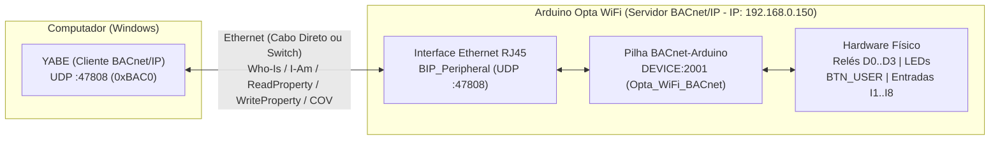
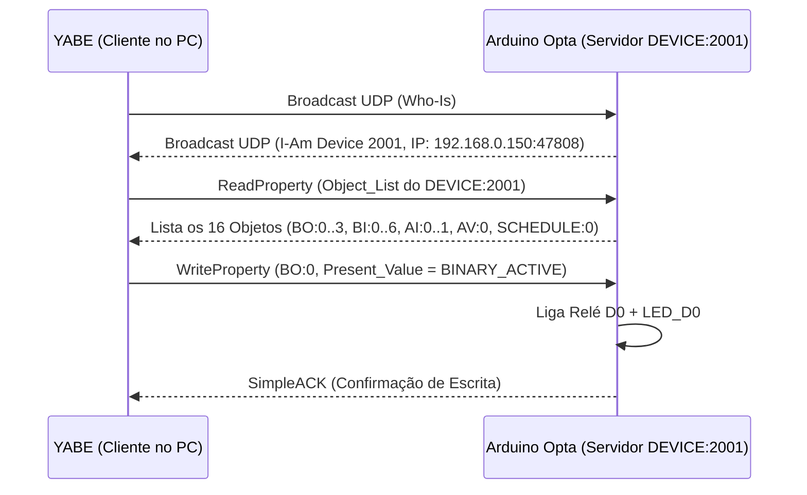

# Documentação Técnica: BACnet/IP no Arduino Opta WiFi

Este documento descreve a arquitetura, as bibliotecas, as **alterações técnicas realizadas nas dependências**, o mapeamento de hardware e o procedimento completo de comissionamento do **Arduino Opta WiFi** operando como **Servidor BACnet/IP (Ethernet)** utilizando a biblioteca `BACnet-Arduino` e o software cliente **YABE (Yet Another BACnet Explorer)**.

---

## Sumário

1. [Visão Geral e Arquitetura](#1-visão-geral-e-arquitetura)
2. [Bibliotecas Utilizadas e Alterações Realizadas](#2-bibliotecas-utilizadas-e-alterações-realizadas)
3. [Configuração do Datalink BACnet/IP](#3-configuração-do-datalink-bacnetip)
4. [Mapeamento de Hardware e Objetos BACnet](#4-mapeamento-de-hardware-e-objetos-bacnet)
5. [Estrutura do Firmware (`Opta_BACnetIP_Test.ino`)](#5-estrutura-do-firmware-opta_bacnetip_testino)
6. [Guia Passo a Passo de Teste no YABE](#6-guia-passo-a-passo-de-teste-no-yabe)
7. [Consumo de Memória e Recursos](#7-consumo-de-memória-e-recursos)
8. [Solução de Problemas (Troubleshooting)](#8-solução-de-problemas-troubleshooting)

---

## 1. Visão Geral e Arquitetura

No protocolo **BACnet (ASHRAE 135 / ISO 16484-5)** sobre IP (**BACnet/IP — Anexo J**), a comunicação ocorre via pacotes **UDP** na porta padrão **`47808` (`0xBAC0`)**:

* **Arduino Opta WiFi (Servidor BACnet/IP / Controlador de Campo)**:
  Hospeda o modelo de dados BACnet (`Device`, `Binary Output`, `Binary Input`, `Analog Input`, `Analog Value`, `Schedule`), atualiza os valores presentes (`Present_Value`) a partir das entradas físicas (`I1–I8` e botão `BTN_USER`), aciona os relés físicos (`D0–D3`) e responde às requisições da rede.
* **YABE — Yet Another BACnet Explorer (Cliente BACnet/IP / Estação de Engenharia)**:
  Simula o papel de um sistema supervisório predial (**BMS / SCADA**). Realiza a descoberta automática de dispositivos na rede (`Who-Is` / `I-Am`), lê a lista de objetos e suas propriedades (`ReadProperty` / `ReadPropertyMultiple`), envia comandos de escrita (`WriteProperty`) respeitando a tabela de prioridades (`Priority_Array`) e assina notificações de mudança de valor (`SubscribeCOV`).



### Fluxo de Comunicação BACnet/IP



---

## 2. Bibliotecas Utilizadas e Alterações Realizadas

Para compilar o projeto para a placa **Arduino Opta** (pacote **`Arduino Mbed OS Opta Boards` — `arduino:mbed_opta:opta` v`4.6.0`**), são utilizadas as seguintes bibliotecas:

| Biblioteca | Versão | Papel no Projeto |
| :--- | :--- | :--- |
| **`BACnet-Arduino`** | `0.7.0` | Pilha de protocolo BACnet (baseada na *bacnet-stack* de Steve Karg) adaptada para Arduino/STM32 |
| **`WeeklyAlarm`** | `5.2.0` *(ajustada)* | Agendador semanal utilizado internamente pelo objeto `Schedule` (`Schedule.h`) da `BACnet-Arduino` |
| **`NTPClient`** | `3.2.1` | Cliente NTP referenciado pelos cabeçalhos da porta Arduino da `BACnet-Arduino` |
| **`Ethernet` / `SocketWrapper`** | `1.0.0` | Bibliotecas nativas do core `arduino:mbed_opta` para comunicação TCP/UDP via RJ45 |

---

### 2.1. Problema 1 Encontrado: Incompatibilidade com `WeeklyAlarm 5.1.0`

Ao instalar a `WeeklyAlarm` na versão **`5.1.0`**, a compilação da `BACnet-Arduino 0.7.0` falha imediatamente em `src/ports/arduino/Schedule.h` (linhas 60, 71 e 82) com o erro:

```text
error: 'tmElements_t' does not name a type
     static BACNET_TIME toBACnetTime(const tmElements_t &t);
```

* **Causa**: A versão `5.1.0` da `WeeklyAlarm` definia apenas a estrutura `WA_TimeElements` quando compilada em plataformas com biblioteca C padrão **Newlib** (`#ifdef __NEWLIB__`, como o STM32H747 do Opta). Somente a partir da versão **`5.2.0`** a `WeeklyAlarm` passou a definir `tmElements_t`, `breakTime()` e `makeTime()` sob `__NEWLIB__`.
* **Solução**: Atualização obrigatória da biblioteca `WeeklyAlarm` para a versão **`5.2.0`**.

---

### 2.2. Problema 2 Encontrado e Alteração Realizada em `WeeklyAlarm 5.2.0` (`src/WeeklyAlarm.h`)

Mesmo utilizando a `WeeklyAlarm 5.2.0` original no **Arduino Opta**, ocorria uma falha crítica no sistema de build da **Arduino IDE / `arduino-cli`**:

#### Diagnóstico Técnico da Causa Raiz
1. Durante a etapa inicial de **descoberta de bibliotecas** (*Library Discovery Phase*), o `arduino-cli` / Arduino IDE invoca o pré-processador `arm-none-eabi-g++` passando a flag `-DARDUINO_LIBRARY_DISCOVERY_PHASE=1` (definida em `platform.txt` do core `arduino:mbed_opta`).
2. No arquivo `Arduino.h` do core `arduino:mbed_opta 4.6.0` (linhas 20–23), existe a seguinte diretiva:
   ```cpp
   #if ARDUINO_LIBRARY_DISCOVERY_PHASE == 1
   #define ARDUINO_LIB_DISCOVERY_PHASE
   #endif
   #if !defined(Arduino_h) && !defined(ARDUINO_LIB_DISCOVERY_PHASE)
   ```
   Ou seja, durante a descoberta de bibliotecas, o `Arduino.h` **pula todo o seu conteúdo** e não inclui `<stdint.h>` nem `<_newlib_version.h>`.
3. Na biblioteca `WeeklyAlarm 5.2.0` original (`src/WeeklyAlarm.h`), o código incluía apenas `"Arduino.h"` e testava imediatamente `#ifdef __NEWLIB__`:
   - Como `__NEWLIB__` é uma macro definida pelos cabeçalhos da Newlib (`<_newlib_version.h>` / `<newlib.h>`) e **não** uma macro embutida do compilador, durante a fase de descoberta `__NEWLIB__` ficava **indefinida**.
   - Isso fazia o pré-processador entrar indevidamente no bloco `#else` (destinado a placas AVR antigas) e exigir `#include <TimeLib.h>`:
     - **Cenário A (sem a biblioteca `Time` instalada)**: a compilação abortava na linha 59 com `fatal error: TimeLib.h: No such file or directory`.
     - **Cenário B (com a biblioteca `Time 1.6.1` instalada)**: a fase de descoberta adicionava `Time.cpp` ao projeto; porém, na compilação real (`ARDUINO_LIBRARY_DISCOVERY_PHASE=0`), `__NEWLIB__` passava a existir, fazendo com que tanto `WeeklyAlarm.cpp` quanto `Time.cpp` definissem as funções `breakTime()` e `makeTime()`, quebrando o *linker* com:
       ```text
       multiple definition of 'breakTime(long long, tmElements_t&)'
       multiple definition of 'makeTime(tmElements_t const&)'
       ```

#### Alteração Aplicada em `WeeklyAlarm/src/WeeklyAlarm.h`

Para garantir que a macro `__NEWLIB__` seja detectada corretamente tanto na fase de descoberta (`ARDUINO_LIBRARY_DISCOVERY_PHASE=1`) quanto na compilação normal — sem afetar placas AVR —, foi adicionada a verificação com `__has_include` logo após `#include "Arduino.h"` nas **linhas 33–39** de `WeeklyAlarm/src/WeeklyAlarm.h`:

**Antes (`WeeklyAlarm 5.2.0` original):**
```cpp
#include "Arduino.h"

#ifdef __NEWLIB__
    #include <time.h>
```

**Depois (`WeeklyAlarm 5.2.0` corrigida neste projeto):**
```cpp
#include "Arduino.h"

#if defined(__has_include)
  #if __has_include(<_newlib_version.h>)
    #include <_newlib_version.h>
  #elif __has_include(<newlib.h>)
    #include <newlib.h>
  #endif
#endif

#ifdef __NEWLIB__
    #include <time.h>
```

Com essa alteração, o compilador do Opta encontra `<_newlib_version.h>` já na fase de descoberta, define `__NEWLIB__`, utiliza o `<time.h>` POSIX nativo do Mbed OS e ignora completamente `<TimeLib.h>`.

---

## 3. Configuração do Datalink BACnet/IP

A biblioteca `BACnet-Arduino` seleciona a camada física/enlace (*datalink*) em tempo de compilação por meio do arquivo:
`BACnet-Arduino/src/ports/arduino/arduino_configs.h` (incluído por `BACnet-Arduino/src/bacnet/config.h`).

Para operar em **BACnet/IP (Ethernet)**, o arquivo `arduino_configs.h` deve estar com os datalinks específicos comentados (pois `config.h` assume `BACDL_BIP` automaticamente como padrão quando nenhum outro datalink está ativo) ou apenas com `#define BACDL_BIP` ativo:

```cpp
//Ethernet configuration
//#define BACDL_BIP //<--- Padrao ativo quando todos estao comentados (ou descomente apenas esta linha)

//MSTP configuration
//#define BACDL_MSTP //<--- Deve permanecer COMENTADO para compilar o projeto BACnet/IP

//Router configuration
//#define BACNET_ROUTER //<--- Deve permanecer COMENTADO
```

> [!IMPORTANT]
> O sketch `Opta_BACnetIP_Test.ino` possui verificações `#if !defined(BACDL_BIP)` e `#if defined(BACDL_MULTIPLE) || defined(BACNET_ROUTER)` nas linhas 32–37. Caso você tenha testado o modo MS/TP anteriormente e deixado `#define BACDL_MSTP` descomentado em `arduino_configs.h`, basta comentá-lo novamente (`//#define BACDL_MSTP`) antes de compilar o projeto BACnet/IP.

---

## 4. Mapeamento de Hardware e Objetos BACnet

O firmware `Opta_BACnetIP_Test/Opta_BACnetIP_Test.ino` configura o Arduino Opta WiFi como o dispositivo **`Opta_WiFi_BACnet` (`DEVICE:2001`)** e expõe **16 objetos BACnet**:

| Tipo de Objeto BACnet | Instância | `Object_Name` | Pino / Recurso no Opta | Direção / Comportamento |
| :--- | :---: | :--- | :--- | :--- |
| **Device** | `2001` | `Opta_WiFi_BACnet` | Controlador STM32H747 | Identidade geral do servidor BACnet/IP |
| **Binary Output (`BO`)** | `0` | `RELAY_1` | `D0` (Relé 1) + `LED_D0` | Escrita/Comando pelo YABE (`BINARY_ACTIVE` = Liga) |
| **Binary Output (`BO`)** | `1` | `RELAY_2` | `D1` (Relé 2) + `LED_D1` | Escrita/Comando pelo YABE (`BINARY_ACTIVE` = Liga) |
| **Binary Output (`BO`)** | `2` | `RELAY_3` | `D2` (Relé 3) + `LED_D2` | Escrita/Comando pelo YABE (`BINARY_ACTIVE` = Liga) |
| **Binary Output (`BO`)** | `3` | `RELAY_4` | `D3` (Relé 4) + `LED_D3` | Escrita/Comando pelo YABE (`BINARY_ACTIVE` = Liga) |
| **Binary Input (`BI`)** | `0` | `BTN_USER` | `BTN_USER` (Botão frontal) | Leitura (`LOW` pressionado → `BINARY_ACTIVE`) |
| **Binary Input (`BI`)** | `1` | `I3_DI` | Entrada `I3` (`A2`) | Leitura digital 12–24 V (`HIGH` → `BINARY_ACTIVE`) |
| **Binary Input (`BI`)** | `2` | `I4_DI` | Entrada `I4` (`A3`) | Leitura digital 12–24 V (`HIGH` → `BINARY_ACTIVE`) |
| **Binary Input (`BI`)** | `3` | `I5_DI` | Entrada `I5` (`A4`) | Leitura digital 12–24 V (`HIGH` → `BINARY_ACTIVE`) |
| **Binary Input (`BI`)** | `4` | `I6_DI` | Entrada `I6` (`A5`) | Leitura digital 12–24 V (`HIGH` → `BINARY_ACTIVE`) |
| **Binary Input (`BI`)** | `5` | `I7_DI` | Entrada `I7` (`A6`) | Leitura digital 12–24 V (`HIGH` → `BINARY_ACTIVE`) |
| **Binary Input (`BI`)** | `6` | `I8_DI` | Entrada `I8` (`A7`) | Leitura digital 12–24 V (`HIGH` → `BINARY_ACTIVE`) |
| **Analog Input (`AI`)** | `0` | `I1_AI_V` | Entrada `I1` (`A0`) | Leitura analógica 0–10 V em `UNITS_VOLTS` (ADC 16 bits) |
| **Analog Input (`AI`)** | `1` | `I2_AI_V` | Entrada `I2` (`A1`) | Leitura analógica 0–10 V em `UNITS_VOLTS` (ADC 16 bits) |
| **Analog Value (`AV`)** | `0` | `TEST_COUNTER` | Variável interna | Incrementa `+1.0` a cada 1 s (ideal para testar *COV* e gráficos) |
| **Schedule** | `0` | *(Padrão da lib)* | Agendador interno | Criado automaticamente pela `BACnet-Arduino` (`MAX_SCHEDULES = 1`) |

### Conversão Analógica 0–10 V no Opta
O conversor A/D é configurado em **16 bits** (`analogReadResolution(16)`, faixa `0..65535` para `0..3,3 V` no pino do microcontrolador). Considerando o divisor resistivo interno das entradas do Opta (`~0,3034`), a tensão em Volts é calculada por:

$$V_{\text{entrada}} = \frac{\text{raw} \times \left(\frac{3{,}3}{65535{,}0}\right)}{0{,}3034}$$

---

## 5. Estrutura do Firmware (`Opta_BACnetIP_Test.ino`)

### 5.1. Configuração de Rede (IP Estático vs. DHCP)
Nas linhas 44–47 do sketch:

```cpp
#define USE_DHCP 0

constexpr uint8_t DEVICE_IP[] = { 192, 168, 0, 150 };
constexpr uint16_t BACNET_UDP_PORT = 47808;  // 0xBAC0
```

* **`USE_DHCP 0` (Padrão recomendado para bancada)**: Configura o Opta com o IP fixo `192.168.0.150` (máscara `255.255.255.0`), permitindo conexão direta por cabo de rede entre o PC e o Opta sem depender de roteador.
* **`USE_DHCP 1`**: Tenta obter endereço IP via servidor DHCP da rede; caso falhe, aplica `DEVICE_IP` automaticamente como *fallback*.

### 5.2. Inicialização da Pilha BACnet/IP
A ponte entre o driver `Ethernet` / `EthernetUDP` do Mbed OS e a pilha `BACnet-Arduino` é feita pelo template `BIP_Peripheral`:

```cpp
EthernetUDP Udp;
BIP_Peripheral<arduino::EthernetClass, EthernetUDP> BIP_Periph(&Ethernet, &Udp, BACNET_UDP_PORT);
```

Na função `setupBacnet()`:
1. `BIP_Periph.begin()` vincula a instância de rede ao transporte BACnet/IP.
2. `bacnet_init(&deviceInfos)` inicializa o objeto `DEVICE:2001` e os manipuladores de serviços BACnet (`Who-Is`, `ReadProperty`, `ReadPropertyMultiple`, `WriteProperty`, `COV`, `DeviceCommunicationControl`, `ReinitializeDevice`, `TimeSynchronization`).
3. `createBinaryOutput()`, `createBinaryInput()`, `createAnalogInput()` e `createAnalogValue()` instanciam os objetos na memória.

### 5.3. Ciclo Principal (`loop()`)
No `loop()`, três tarefas mantêm o servidor responsivo:
1. **Temporizadores BACnet**: `Device_Timer(nowMs - lastMs)` atualiza os temporizadores de pacotes/COV em milissegundos, e `dcc_timer_seconds(1)` é chamado a cada 1 segundo junto com a atualização das entradas analógicas `AI:0..1` e do contador `AV:0`.
2. **Processamento de Rede**: `bacnet_Poll()` verifica pacotes UDP recebidos na porta `47808` e despacha para `npdu_handler()`.
3. **Sincronização de E/S**:
   - `syncOutputsFromBacnet()` lê `Binary_Output_Present_Value(0..3)` e atualiza os relés `D0–D3` e `LED_D0–LED_D3` quando há alteração.
   - `syncInputsToBacnet()` monitora o botão `BTN_USER` e as entradas `I3–I8`, chamando `Binary_Input_Present_Value_Set()` imediatamente em qualquer mudança de estado.

---

## 6. Guia Passo a Passo de Teste no YABE

### Passo 1: Preparar a Rede entre o PC e o Opta
1. Conecte um cabo de rede RJ45 entre o **Arduino Opta** e o seu **PC** (ou ao mesmo switch/roteador).
2. Caso esteja usando `USE_DHCP 0` (`192.168.0.150`), certifique-se de que a placa de rede Ethernet do Windows esteja na mesma faixa (ex.: IP `192.168.0.100`, máscara `255.255.255.0`).
3. Grave o sketch `Opta_BACnetIP_Test.ino` no Opta e abra o Monitor Serial (`115200` baud) para confirmar:
   ```text
   === Arduino Opta WiFi - Teste BACnet/IP ===
   [Net] Iniciando Ethernet com IP estatico...
   [Net] IP do Opta: 192.168.0.150
   [Net] Porta UDP BACnet/IP: 47808
   [Net] Link fisico: LinkON (Cabo OK)
   [BACnet] Servidor pronto! Abra o YABE e faca a descoberta (Who-Is).
   ```

### Passo 2: Abrir o Canal BACnet/IP no YABE
1. Abra o **YABE** e clique no ícone **`+`** (*Add device / Start communication channel*) na barra superior.
2. Na seção **`BACnet/IP V4 & V6 over Udp`**:
   - **`Port`**: mantenha **`BAC0`** (`47808`).
   - **`Local endpoint`**: selecione na lista suspensa o endereço IP da placa Ethernet do seu PC (ex.: `192.168.0.100`).
3. Clique no botão **`Start`** dentro do quadro *BACnet/IP V4 & V6 over Udp*.

### Passo 3: Descobrir e Inspecionar os Objetos
1. O YABE enviará automaticamente um `Who-Is` na rede e exibirá **`Opta_WiFi_BACnet (DEVICE:2001)`** na árvore **Devices** (canto superior esquerdo).
2. Clique sobre **`Opta_WiFi_BACnet (DEVICE:2001)`**: a lista **Objects** (canto inferior esquerdo) exibirá todos os **16 objetos** do Opta.

### Passo 4: Acionar os Relés (`D0–D3`) pelo YABE
1. Na lista **Objects**, clique em **`OBJECT_BINARY_OUTPUT:0`** (correspondente ao `RELAY_1` / saída `D0`).
2. No painel **Properties** (à direita), localize a propriedade **`Present_Value`**.
3. Clique no valor **`BINARY_INACTIVE`**, mude para **`BINARY_ACTIVE`** e pressione **Enter**:
   - O relé `D0` atracará imediatamente e o `LED_D0` acenderá no topo do Opta.
   - O Monitor Serial registrará: `[BACnet -> Opta] RELAY_1 = ACTIVE (ON)`.
4. Para desligar o relé, volte em **`Present_Value`**, selecione **`BINARY_INACTIVE`** e pressione **Enter**.

### Passo 5: Monitorar o Botão (`BTN_USER`), Entradas e Contador em Tempo Real
1. Arraste **`OBJECT_BINARY_INPUT:0`** (`BTN_USER`) e **`OBJECT_ANALOG_VALUE:0`** (`TEST_COUNTER`) da lista **Objects** para a área central (**Subscriptions, Periodic Polling, Events/Alarms**).
2. Pressione o botão físico **`BTN_USER`** no Arduino Opta e observe o valor alternar em tempo real entre `BINARY_INACTIVE` e `BINARY_ACTIVE` na tabela e no gráfico do YABE.

---

## 7. Consumo de Memória e Recursos

Resultado obtido na compilação limpa (`arduino-cli compile --fqbn arduino:mbed_opta:opta`):

* **Memória Flash (Programa)**: `312.988 bytes` (**15%** do total de `1.966.080 bytes`)
* **Memória RAM (Variáveis Globais)**: `103.608 bytes` (**19%** do total de `523.624 bytes`, deixando `420.016 bytes` livres para pilha e variáveis locais)

---

## 8. Solução de Problemas (Troubleshooting)

| Sintoma | Causa Provável | Solução |
| :--- | :--- | :--- |
| Erro `'tmElements_t' does not name a type` ao compilar | Biblioteca `WeeklyAlarm` antiga (`5.1.0`) instalada na pasta da Arduino IDE | Substitua a pasta `WeeklyAlarm` em `Documentos\Arduino\libraries` pela versão `5.2.0` corrigida deste projeto (`WeeklyAlarm.zip`). |
| Erro `#error "Este sketch requer BACDL_BIP habilitado"` | `#define BACDL_MSTP` foi deixado descomentado em `arduino_configs.h` após testes MS/TP | Edite `BACnet-Arduino/src/ports/arduino/arduino_configs.h` na pasta `libraries` da Arduino IDE e comente `//#define BACDL_MSTP`. |
| YABE abre a porta `Udp:47808`, mas não encontra o Opta | Placa de rede errada selecionada no `Local endpoint`, sub-rede diferente ou Firewall do Windows | Selecione o IP da interface Ethernet correta em `Local endpoint`, confirme o `ping 192.168.0.150` no terminal do Windows e libere o YABE na porta UDP `47808` no Firewall. |
| Monitor Serial exibe `LinkOFF (Verifique cabo)` | Cabo RJ45 desconectado no momento da inicialização (`setupNetwork()`) | Conecte o cabo Ethernet antes de energizar ou pressione o botão Reset do Opta após conectar o cabo. |

