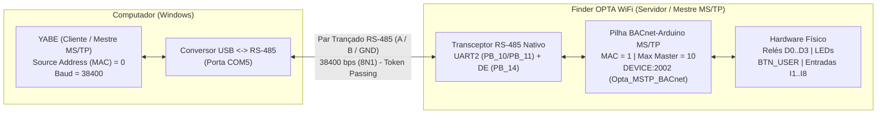
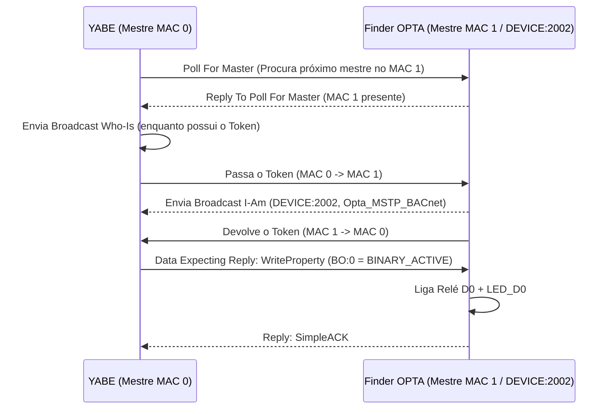

# Documentação Técnica: BACnet MS/TP (RS-485) no Finder OPTA WiFi

Este documento descreve a arquitetura, a ligação física RS-485, as **alterações técnicas realizadas nas bibliotecas**, a implementação dos *callbacks* de transporte e o guia completo de conexão e solução de problemas do **Finder OPTA WiFi** operando em **BACnet MS/TP (RS-485)** com o software cliente **YABE (Yet Another BACnet Explorer)**.

---

## Sumário

1. [Visão Geral e Arquitetura BACnet MS/TP](#1-visão-geral-e-arquitetura-bacnet-mstp)
2. [Bibliotecas Utilizadas e Alterações Realizadas](#2-bibliotecas-utilizadas-e-alterações-realizadas)
3. [Ligação Física RS-485 (PC ↔ Finder OPTA)](#3-ligação-física-rs-485-pc--finder-opta)
4. [Callbacks de Transporte e Temporização RS-485](#4-callbacks-de-transporte-e-temporização-rs-485)
5. [Mapeamento de Hardware e Objetos BACnet](#5-mapeamento-de-hardware-e-objetos-bacnet)
6. [Guia Passo a Passo de Conexão no YABE](#6-guia-passo-a-passo-de-conexão-no-yabe)
7. [Solução do Erro de Driver USB-RS485 (CH340) no Windows 10/11](#7-solução-do-erro-de-driver-usb-rs485-ch340-no-windows-1011)
8. [Consumo de Memória e Troubleshooting Geral](#8-consumo-de-memória-e-troubleshooting-geral)

---

## 1. Visão Geral e Arquitetura BACnet MS/TP

O **BACnet MS/TP (*Master-Slave / Token-Passing* — Cláusula 9 da norma ASHRAE 135)** é o protocolo de barramento de campo padrão em automação predial sobre par trançado **RS-485 (EIA-485)**:

* **Controle de Acesso por Passagem de Token (*Token Passing*)**:
  Como o barramento RS-485 é *half-duplex* (apenas um dispositivo pode transmitir por vez), todos os nós **Mestres** (endereços MAC de `0` a `127`) revezam um quadro especial chamado **Token**. Apenas o mestre que detém o Token naquele instante pode iniciar requisições (`Who-Is`, `ReadProperty`, `WriteProperty`).
* **Endereçamento MAC MS/TP vs. Device Instance**:
  - **MAC Address MS/TP (`1 byte`, `0..127` para mestres)**: endereço físico local no barramento RS-485. No nosso projeto:
    - **YABE (PC)**: `MAC = 0` (`Source Address = 0`)
    - **Finder OPTA**: `MAC = 1` (`MSTP_UNIT_MAC = 1`)
  - **BACnet Device Instance (`0..4194302`)**: identificador lógico único do controlador no sistema BACnet. No nosso projeto MS/TP: **`DEVICE:2002`** (`Opta_MSTP_BACnet`).



### Ciclo de Passagem de Token e Requisição no Barramento RS-485



---

## 2. Bibliotecas Utilizadas e Alterações Realizadas

| Biblioteca | Versão | Papel no Projeto |
| :--- | :--- | :--- |
| **`BACnet-Arduino`** | `0.7.0` *(configurada para MS/TP)* | Pilha BACnet com suporte a MS/TP (`BACnet-Arduino_MSTP.h` e `dlmstp`) |
| **`WeeklyAlarm`** | `5.2.0` *(ajustada)* | Agendador semanal exigido por `Schedule.h` da `BACnet-Arduino` |
| **`ArduinoRS485`** | `1.1.1` | Driver RS-485 oficial para controle do transceptor e pino `DE` do Finder OPTA |
| **`NTPClient`** | `3.2.1` | Dependência dos cabeçalhos da porta Arduino da `BACnet-Arduino` |

---

### 2.1. Alteração 1: Ativação do Datalink `BACDL_MSTP` em `arduino_configs.h`

Por padrão, a biblioteca `BACnet-Arduino` vem configurada para BACnet/IP (`BACDL_BIP`). Para compilar em modo **BACnet MS/TP**, foi necessário habilitar a macro `BACDL_MSTP` no arquivo:
`BACnet-Arduino/src/ports/arduino/arduino_configs.h` (linha 12).

**Antes (Padrão BACnet/IP):**
```cpp
//Ethernet configuration
//#define BACDL_BIP //<--- Uncomment

//MSTP configuration
//#define BACDL_MSTP //<--- Uncomment
```

**Depois (Habilitado para BACnet MS/TP):**
```cpp
//Ethernet configuration
//#define BACDL_BIP //<--- Uncomment

//MSTP configuration
#define BACDL_MSTP //<--- Uncomment
```

> [!WARNING]
> **Atenção ao local da biblioteca na Arduino IDE:**
> A Arduino IDE compila utilizando a cópia instalada em `C:\Users\<SeuUsuario>\OneDrive\Documentos\Arduino\libraries\BACnet-Arduino\src\ports\arduino\arduino_configs.h` (ou `Documentos\Arduino\libraries\...`). Certifique-se de que `#define BACDL_MSTP` esteja descomentado **nessa pasta** ao compilar pela Arduino IDE. Caso contrário, a proteção na linha 36 do sketch disparará `#error "Este sketch requer BACDL_MSTP habilitado..."`.

---

### 2.2. Alteração 2: Correção da Detecção `__NEWLIB__` em `WeeklyAlarm/src/WeeklyAlarm.h`

Assim como no projeto BACnet/IP, a compilação no core `arduino:mbed_opta` (`4.6.0`) exige o ajuste nas **linhas 33–39** de `WeeklyAlarm/src/WeeklyAlarm.h`.

Durante a fase de descoberta de bibliotecas da Arduino IDE (`-DARDUINO_LIBRARY_DISCOVERY_PHASE=1`), o cabeçalho `Arduino.h` do Opta ignora suas inclusões internas (`#if !defined(Arduino_h) && !defined(ARDUINO_LIB_DISCOVERY_PHASE)`), fazendo com que a macro `__NEWLIB__` não esteja definida antes da linha `#ifdef __NEWLIB__` da `WeeklyAlarm.h`. Sem o ajuste abaixo, a biblioteca tenta incluir `<TimeLib.h>` indevidamente e falha na compilação ou na etapa de *link* (`multiple definition of breakTime / makeTime`):

```cpp
#include "Arduino.h"

#if defined(__has_include)
  #if __has_include(<_newlib_version.h>)
    #include <_newlib_version.h>
  #elif __has_include(<newlib.h>)
    #include <newlib.h>
  #endif
#endif

#ifdef __NEWLIB__
    #include <time.h>
```

---

### 2.3. Alteração 3: Inclusão de `<mbed_rtc_time.h>` no Sketch MS/TP

No sketch BACnet/IP, o cabeçalho `<Ethernet.h>` incluía indiretamente `<mbed_rtc_time.h>` (onde a função `set_time()` do RTC interno do STM32H747 é declarada). Como o sketch MS/TP não utiliza `<Ethernet.h>`, foi incluído explicitamente em `Opta_BACnetMSTP_Test.ino` (linha 31):

```cpp
#include <mbed_mktime.h>
#include <mbed_rtc_time.h>
#include <time.h>
```

---

## 3. Ligação Física RS-485 (PC ↔ Finder OPTA)

Na parte inferior do **Finder OPTA WiFi**, localize o conector de 3 bornes identificado como **RS485**:

| Borne no Finder OPTA | Terminal no Conversor USB-RS485 | Descrição do Sinal |
| :---: | :---: | :--- |
| **`A (-)`** | **`A`** (ou `D-` / `TR-`) | Linha diferencial inversora RS-485 |
| **`B (+)`** | **`B`** (ou `D+` / `TR+`) | Linha diferencial não-inversora RS-485 |
| **`GND`** | **`GND`** *(se disponível)* | Referência de modo comum RS-485 |

> [!TIP]
> **Inversão de polaridade A/B entre fabricantes:**
> Enquanto a norma EIA-485 define `A` como negativo (`-`) e `B` como positivo (`+`) — padrão seguido pela serigrafia do Finder OPTA (`A(-)`, `B(+)`) —, diversos conversores USB-RS485 comerciais rotulam `A` como `+` e `B` como `-`. Se a porta COM abrir normalmente no YABE mas nenhum dispositivo aparecer na busca, inverta os dois fios `A` e `B` no conector do conversor. Inversão entre `A` e `B` não danifica o transceptor RS-485.

---

## 4. Callbacks de Transporte e Temporização RS-485

A implementação MS/TP da `BACnet-Arduino` é independente de hardware e se comunica com a porta serial por meio de **três funções de callback** configuradas em `Opta_BACnetMSTP_Test.ino` (linhas 135–163):

### 4.1. Leitura de Bytes (`rs485_read`)
Quando chamada com `b == nullptr`, apenas informa se há byte disponível no buffer de recepção; quando `b != nullptr`, lê e retorna o próximo byte recebido pela UART RS-485:

```cpp
static bool rs485_read(uint8_t *b)
{
    if (RS485.available()) {
        if (b == nullptr) {
            return true;
        }
        *b = static_cast<uint8_t>(RS485.read());
        return true;
    }
    if (b != nullptr) {
        *b = 0;
    }
    return false;
}
```

### 4.2. Envio de Quadro (`rs485_send`)
Desabilita o receptor, ativa o pino *Driver Enable* (`DE`), transmite o quadro MS/TP completo, zera o temporizador de silêncio do barramento (`mstp_silence_reset()`), aguarda o término da transmissão física e retorna ao modo de escuta:

```cpp
static void rs485_send(const uint8_t *p, uint16_t len)
{
    RS485.noReceive();
    RS485.beginTransmission();
    RS485.write(p, len);
    mstp_silence_reset();
    RS485.endTransmission();
    RS485.receive();
}
```

### 4.3. Estado de Transmissão (`rs485_transmitting`)
Informa à máquina de estados MS/TP se o transceptor RS-485 ainda está em transmissão física monitorando o pino `RS485_DEFAULT_DE_PIN` (`PB_14` no Opta):

```cpp
static bool rs485_transmitting()
{
    return digitalRead(DE_PIN) == HIGH;
}
```

### 4.4. Cálculo do Atraso Pós-Transmissão (`RS485_POSTDELAY`)
O protocolo MS/TP é sensível ao tempo em que o pino `DE` permanece ativo após o último bit enviado. Um valor de aproximadamente **1,5 tempos de caractere (15 tempos de bit)** garante que o último bit de parada (*stop bit*) saia completamente pelo transceptor antes de liberar o barramento:

$$\text{RS485\_POSTDELAY}\ (\mu\text{s}) = \frac{15 \times 10^6}{\text{BACNET\_MSTP\_BAUD}}$$

Para `BACNET_MSTP_BAUD = 38400`, temos $\text{RS485\_POSTDELAY} = 390\ \mu\text{s}$, configurado via `RS485.setDelays(25, RS485_POSTDELAY)`.

---

## 5. Mapeamento de Hardware e Objetos BACnet

O sketch `Opta_BACnetMSTP_Test.ino` configura o dispositivo **`Opta_MSTP_BACnet` (`DEVICE:2002`)** com os seguintes parâmetros e objetos:

* **Parâmetros de Rede MS/TP** (linhas 48–50):
  - `MSTP_UNIT_MAC = 1` (Endereço MAC do Opta)
  - `MSTP_MAX_MASTER = 10` (`Nmax_master`)
  - `BACNET_MSTP_BAUD = 38400` (Taxa de comunicação serial)

| Tipo de Objeto BACnet | Instância | `Object_Name` | Pino / Recurso no Opta | Direção / Comportamento |
| :--- | :---: | :--- | :--- | :--- |
| **Device** | `2002` | `Opta_MSTP_BACnet` | Controlador STM32H747 | Identidade do servidor BACnet MS/TP |
| **Binary Output (`BO`)** | `0..3` | `RELAY_1..4` | `D0..D3` + `LED_D0..LED_D3` | Comando dos 4 relés (`BINARY_ACTIVE` = Liga) |
| **Binary Input (`BI`)** | `0` | `BTN_USER` | Botão frontal `BTN_USER` | Leitura (`LOW` pressionado → `BINARY_ACTIVE`) |
| **Binary Input (`BI`)** | `1..6` | `I3_DI..I8_DI` | Entradas `I3..I8` (`A2..A7`) | Leitura digital 12–24 V (`HIGH` → `BINARY_ACTIVE`) |
| **Analog Input (`AI`)** | `0..1` | `I1_AI_V..I2_AI_V` | Entradas `I1..I2` (`A0..A1`) | Leitura analógica 0–10 V em `UNITS_VOLTS` |
| **Analog Value (`AV`)** | `0` | `TEST_COUNTER` | Variável interna | Contador de 1 s (`+1.0/s`) para teste de Polling/COV |
| **Schedule** | `0` | *(Padrão da lib)* | Agendador interno | Criado automaticamente pela biblioteca |

---

## 6. Guia Passo a Passo de Conexão no YABE

1. Grave o sketch `Opta_BACnetMSTP_Test.ino` no Finder OPTA.
2. Abra o **YABE** e clique no botão **`+`** (*Add device / Start communication channel*).
3. Na janela **BACnet Communication Channel**, localize o quadro **`BACnet/MSTP over serial`** (à direita) e preencha:
   - **`Port`**: selecione a porta `COM` do seu **conversor USB-RS485** (ex.: **`COM5`**). *Não selecione a porta COM do cabo USB-C do Opta (`COM4`).*
   - **`Baud`**: **`38400`** (idêntico ao `BACNET_MSTP_BAUD` do sketch).
   - **`Source Address`**: **`0`** *(mude de `-1` para `0`)*.
     > **Importante**: no YABE, o valor padrão `-1` significa **modo passivo (apenas monitor/sniffer)**. Nesse modo, o YABE não participa do giro do Token, não envia `Who-Is` e não consegue acionar saídas. Definindo `Source Address = 0`, o YABE atua como Mestre MAC `0` e troca o Token com o Opta (MAC `1`).
   - **`Max Master`**: **`10`** (alinha com `MSTP_MAX_MASTER = 10` do Opta para deixar a busca de mestres rápida).
   - **`Max Frames`**: **`1`**.
4. Clique em **`Start`** dentro do quadro *BACnet/MSTP over serial*.
5. O YABE abrirá o barramento serial, descobrirá **`Opta_MSTP_BACnet (DEVICE:2002)`** no endereço MAC `1` e carregará todos os 16 objetos na lista **Objects**.
6. Para acionar qualquer relé (`D0–D3`), clique em **`OBJECT_BINARY_OUTPUT:0`** (a `3`) e altere **`Present_Value`** de `BINARY_INACTIVE` para **`BINARY_ACTIVE`**.

---

## 7. Solução do Erro de Driver USB-RS485 (CH340) no Windows 10/11

Ao utilizar conversores USB-RS485 baseados no chip **WCH CH340** (`USB-SERIAL CH340`) no Windows 10 ou Windows 11, clicar em **Start** no YABE pode apresentar o seguinte erro:

> ❌ **`Couldn't start BACnet communication: Um dispositivo conectado ao sistema não está funcionando.`**

### 7.1. Causa Técnica
O Windows Update instala automaticamente o driver `wch.cn` **`CH341SER` versão `3.8` (2023) ou `3.9.2024.9` (`16/09/2024`)**. Essas versões recentes introduziram uma verificação que falha na chamada de sistema `SetCommState()` (utilizada pela classe `.NET System.IO.Ports.SerialPort` do YABE) na maioria dos chips CH340 presentes em conversores USB-RS485 do mercado.

> Esse erro ocorre na abertura da porta USB no Windows e **não tem relação com os fios A/B do barramento RS-485**.

### 7.2. Procedimento de Correção Definitiva (Downgrade para v3.4 de 2014)

1. Baixe e execute o instalador oficial da versão estável **`3.4` (`08/08/2014`)** do driver CH340 (`CH341SER.EXE` — disponível em: https://cdn.sparkfun.com/assets/learn_tutorials/8/4/4/CH341SER.EXE) clicando em **INSTALL**.
2. Como o driver `3.9 (2024)` possui data mais recente, o Windows pode continuar selecionando a versão `3.9` automaticamente. Para forçar o uso da versão `3.4 (2014)`:
   - Abra o **Gerenciador de Dispositivos** do Windows → expanda **Portas (COM e LPT)**.
   - Clique com o botão direito em **`USB-SERIAL CH340 (COMx)`** → **Propriedades** → aba **Driver**.
   - Clique em **"Atualizar Driver..."**.
   - Selecione **"Procurar drivers no meu computador"**.
   - Selecione **"Permitir que eu escolha em uma lista de drivers disponíveis em meu computador"**.
   - Na lista exibida, selecione **`USB-SERIAL CH340 Versão: 3.4.2014.8 [08/08/2014]`** (não selecione a `3.9.2024.9`) e clique em **Avançar** → **Fechar**.
3. Confirme na aba **Driver** que a versão ativa agora é **`3.4.2014.8`** (`08/08/2014`) e clique em **Start** novamente no YABE.

---

## 8. Consumo de Memória e Troubleshooting Geral

### 8.1. Recursos Utilizados no Finder OPTA
Resultado obtido na compilação limpa (`arduino-cli compile --fqbn arduino:mbed_opta:opta`):

* **Memória Flash (Programa)**: `260.636 bytes` (**13%** do total de `1.966.080 bytes`)
* **Memória RAM (Variáveis Globais)**: `102.424 bytes` (**19%** do total de `523.624 bytes`, deixando `421.200 bytes` livres para variáveis locais)

### 8.2. Tabela de Diagnóstico Rápido

| Sintoma | Causa Provável | Solução |
| :--- | :--- | :--- |
| Erro `#error "Este sketch requer BACDL_MSTP habilitado..."` ao compilar | `#define BACDL_MSTP` está descomentado apenas na cópia local do projeto, mas não na pasta `libraries` da Arduino IDE | Abra `C:\Users\<Usuario>\OneDrive\Documentos\Arduino\libraries\BACnet-Arduino\src\ports\arduino\arduino_configs.h` e descomente `#define BACDL_MSTP` na linha 12. |
| Erro `"Um dispositivo conectado ao sistema não está funcionando"` no YABE | Driver CH340 `3.9.2024.9` ativo no Windows 11 | Selecione o driver `3.4.2014.8 [08/08/2014]` no Gerenciador de Dispositivos conforme a [Seção 7](#7-solução-do-erro-de-driver-usb-rs485-ch340-no-windows-1011). |
| Porta COM abre no YABE, mas `Opta_MSTP_BACnet` não aparece | 1) `Source Address` deixado em `-1` no YABE<br>2) Fios `A` e `B` invertidos<br>3) Baud rate diferente | 1) Mude `Source Address` para **`0`** no YABE<br>2) Inverta os fios `A(-)` e `B(+)` no conversor USB-RS485<br>3) Confirme `Baud = 38400` nos dois lados. |
| Descoberta MS/TP muito lenta no YABE | `Max Master` muito alto (`127`) com poucos dispositivos na rede | Use `Max Master = 10` no YABE (igual ao `MSTP_MAX_MASTER = 10` do sketch). |

